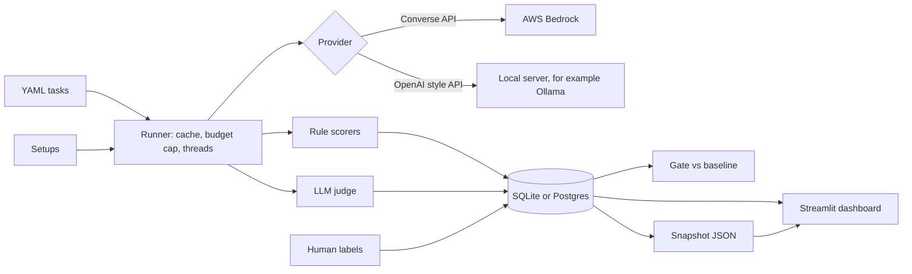

# Design

## Overview

## Components

| Part | File | What it does |
|---|---|---|
| Tasks | `gauge/tasks.py`, `tasks/*.yaml` | Loads and validates tasks. Categories decide the checker. |
| Setups | `gauge/setups.py` | A model, a system prompt, tools on or off, and which provider. |
| Providers | `gauge/providers.py` | Bedrock (Converse API, retries, tool loop), a local OpenAI style provider, a fake one for tests, and a router. |
| Tools | `gauge/tools.py` | Calculator, company lookup and help search. Local and deterministic. |
| Scoring | `gauge/scoring.py` | Rule checks. Pure functions, no network. |
| Judge | `gauge/judge.py` | Asks a cheap model for a verdict. Only a second opinion. |
| Runner | `gauge/runner.py` | Runs jobs in threads, caches by a key, enforces the budget cap. |
| Storage | `gauge/db.py` | SQLAlchemy tables for runs, results and labels. |
| Stats | `gauge/stats.py` | Accuracy, percentiles, categories, unstable tasks, judge agreement. |
| Gate | `gauge/gate.py` | Compares accuracy to a baseline file. |
| Regression demo | `gauge/regress.py` | Breaks a setup with a bad prompt and runs the gate. |
| Load test | `gauge/loadtest.py` | Sends requests at several concurrency levels. |
| Dashboard | `app/dashboard.py`, `app/label_app.py` | Views and the labeling tool. |

## Decisions and why

- **Rules first, judge second.** Most tasks have one correct value, so rules are cheaper and stricter. The judge is
  measured against my own labels instead of being trusted.
- **Throttling is not a wrong answer.** A call that never reached the model is left out of accuracy. A model that invents a
  tool name or loops is the model's mistake and counts.
- **Cache key includes the prompt, model, task, repeat and limits.** Changing anything that could change an answer re runs it.
- **Backoff outside the latency clock.** Retry waits are stored separately so a throttled call does not make a model look slow.
- **Two kinds of baseline.** `baseline.json` is for the full run (8 setups, 2 repeats). `baseline-ci.json` is for the
  scheduled job (2 cheap models, 1 repeat, all tasks). They are different samples, so they are never compared with each other.
- **Seeded regression uses the real gate.** The demo does not special case anything. It only swaps the system prompt.
- **Keyless CI.** GitHub gets short lived AWS access through OpenID Connect. See `docs/aws-github-setup.md`.

## Known limits

See "Known limits" in the README.
